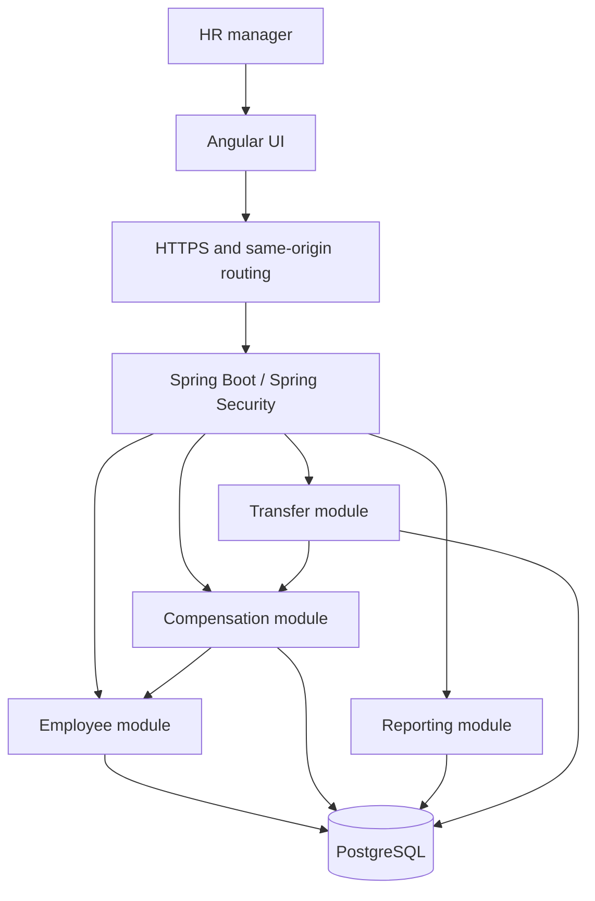

# Backend architecture

Status: module boundaries, shared MVC infrastructure, PostgreSQL persistence, authentication, employee reads, and the salary-change transaction are implemented. Reporting and transfer workflows below remain the design baseline. Product scope is defined in [requirements](requirements.md); decisions and alternatives are in [decisions](decisions.md).

## Runtime topology

One Spring Boot application and one PostgreSQL database. Serve Angular and /api under one HTTPS origin through a reverse proxy. Begin with one backend instance; persist sessions in PostgreSQL so restarts do not require an external cache.

Identity, audit, and reference-data modules are omitted from this runtime diagram for readability; the dependency contract below is authoritative.

## Module ownership and allowed dependencies

Packages beneath com.acme.salary are Spring Modulith application modules. Expose narrow public APIs or named interfaces; keep repositories and entities internal. Verify permitted dependencies and absence of cycles with architecture tests.

| Module | Owns | May depend on |
|---|---|---|
| platform | Internal MVC error advice and request correlation filter; no business rules | No application modules |
| identity | HR accounts, authentication, security configuration | No business modules |
| reference | Departments, countries, currencies, immutable FX rate sets | No business modules |
| audit | Append-only business audit records and a synchronous append API | No business modules |
| employee | Employee identity, employment attributes, aggregate version, directory query API | reference, audit |
| compensation | Salary periods, salary-change use case, compensation queries | employee, reference, audit |
| reporting | Read-only report projections and queries | employee and compensation published read contracts, reference |
| transfer | CSV previews, validated rows, import status, export orchestration | employee, compensation, reference, audit |

The technical platform module is auto-discovered by Spring, exposes no business API, and is not an allowed dependency of business modules. Business modules currently contain boundary declarations only; contracts are introduced alongside actual use cases. Architecture tests assert all eight modules are discovered and use isolated negative fixtures to prove forbidden edges, internal access, and cycles are rejected.

Controllers derive a trusted actor from the authenticated principal and pass an actor ID to use cases; modules must not depend on identity internals. Common configuration must not become a shared business-logic module.

Within a module, separate HTTP adapters, application use cases, domain rules, and persistence where complexity warrants it. Use records for API DTOs. Do not expose JPA entities over HTTP or introduce interfaces for every class.

## Database boundary for reporting

Modules own writes to their tables. Employee and compensation expose documented SQL read views (current employee attributes and salary periods) in addition to Java APIs. Reporting may join these views with reference data using explicit SQL; it must not write owner tables or import their repositories/entities. View changes evolve through migrations and contract tests. This deliberate read-only exception avoids loading 10,000 records or issuing per-employee calls.

## Salary-change transaction

1. Validate amount, currency, reason, and effective date using an injected UTC Clock.
2. Atomically claim the employee version through its public API: conditional version increment where id and expectedVersion match. Zero affected rows yields a conflict (or not found after existence check).
3. Read the latest salary period; require a strictly later start date no later than today.
4. Close its exclusive end date and insert the new open-ended period.
5. Append a business audit record synchronously in the same database transaction.
6. Commit and return the new employee version and salary record.

The version claim holds a database row lock until commit; every employee or salary mutation must use the same protocol. Any failure rolls back the version increment, period changes, and audit. Database constraints provide an additional safety net. Do not use asynchronous events for required audit writes.

## Imports

Validate a bounded UTF-8 CSV (initial limits: 10 MiB and 10,000 data rows), persist a normalized preview and hash, and bind it to the initiating HR user. Expire unapplied previews after 24 hours. Apply the stored preview, never replacement client rows.

Apply in one transaction: lock the import row, check owner/expiry/status, revalidate reference data and employee versions, process existing employees in stable ID order, write changes/audits, and mark APPLIED. Unique employee numbers protect concurrent creations. An already-applied request returns its existing receipt. Any row failure rolls back the whole apply. Validation does not reserve employee data; stale previews must be regenerated. Bounded imports can run synchronously initially; measure runtime before introducing background execution.

## Security and operations

Use Spring Security, adaptive password hashing, session fixation protection, secure HttpOnly SameSite=Lax session cookies, CSRF checks on unsafe requests including login/logout, and PostgreSQL-backed sessions. Supply Angular with a CSRF token through a safe endpoint; refresh it after authentication. No browser-local-storage bearer tokens.

Authorize all business APIs as HR. Expose only minimal public health information; restrict detailed metrics. Disable request/response body logging for compensation and import endpoints. Operational logs contain correlation IDs, timings, and safe error codes; business audits are sensitive database records.

Flyway owns schema changes; runtime schema generation is disabled. Separate migration and runtime database privileges where hosting permits. Use Actuator/Micrometer and structured logs, without claiming monitoring infrastructure is already deployed.

## Verification and performance

- Unit tests: money, dates, currency conversion, report math, CSV validation; fixed clocks and seeded inputs.
- PostgreSQL integration tests: migrations, constraints, rollback, concurrent version claims, report views, and duplicate import application.
- Security/API tests: unauthorized access, CSRF, validation, pagination, error shapes.
- Architecture tests: module boundaries and cycles.
- Later UI end-to-end tests: login, search, salary update, history, import.
- Measure paginated search and reports against 10,000 seeded employees; record latency, query counts, hardware, and query plans. Add indexes or caches only against observed bottlenecks.

## Technology baseline

Planned: Java 25 LTS, Spring Boot 4.1 family, compatible Spring Modulith/Security/Data, Spring MVC, PostgreSQL, Flyway, Maven Wrapper, JUnit, Mockito, Testcontainers, Docker, and GitHub Actions. These are targets, not resolved dependencies. During bootstrap verify official compatibility and deployment support, pin stable versions and container images, and document any adjustment. Do not select milestone or RC releases merely for novelty.
