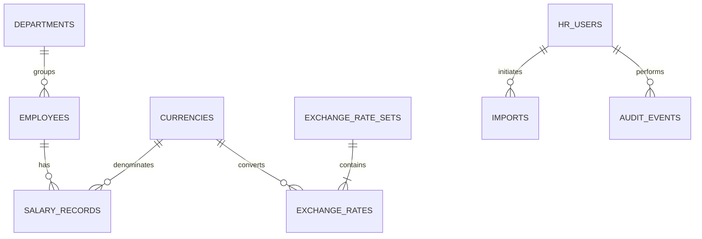

# Data model and invariants

Status: logical design; migrations and executable constraints arrive in later commits.

## Entities

| Table / owner | Essential fields and constraints |
|---|---|
| hr_users / identity | UUID id; normalized unique email; password_hash; role=HR; enabled; created_at |
| departments / reference | UUID id; unique name |
| countries / reference | two-character code; name |
| currencies / reference | three-character code; supported minor-unit precision |
| employees / employee | UUID id; unique employee_number; normalized unique email; full_name; department_id; country_code; job_title; job_level; ACTIVE/INACTIVE status; nonnegative bigint version; created_at; updated_at |
| salary_records / compensation | UUID id; employee_id; positive NUMERIC(19,4) annual_base_amount; currency_code; effective_from DATE; nullable exclusive effective_to DATE; nonblank reason; actor_id; created_at |
| exchange_rate_sets / reference | UUID id; reporting_currency; as_of_date; label; created_at; immutable after publication |
| exchange_rates / reference | rate_set_id + source_currency composite key; positive NUMERIC(24,12) rate |
| audit_events / audit | UUID id; actor_id; entity_type; entity_id; action; before_values/after_values JSONB; reason; occurred_at; request_id; optional import_id |
| imports / transfer | UUID id; owner_id; content_hash; normalized preview; expected employee versions; VALIDATED/INVALID/APPLIED status; errors; created_at; expires_at; applied_at; receipt |
| Spring Session tables / identity | Framework-managed session metadata and attributes; migrated using the schema for the pinned dependency |

Use TIMESTAMPTZ for instants, DATE for salary business dates, and UTC for the application's business clock. UUIDs are server-generated identifiers, not authorization controls. Foreign keys enforce referenced identities. No hard-delete workflow in the initial release.

## Relationships

An employee is created with an initial salary atomically; active employees must have a salary covering today. Cross-table coverage is an application invariant verified by integration tests and seed validation, not an assumed foreign-key property.

## Temporal compensation

Periods use [effective_from, effective_to); NULL end means unbounded. Require end > start when present. Add a unique (employee_id, effective_from), a partial unique index for one open period, and a PostgreSQL GiST exclusion constraint on employee_id and daterange to reject overlaps (requires btree_gist). Check extension support before deployment.

Append-only changes close the previous period and add a new one in a transaction. Do not edit an older period's amount. A second change with the same effective date is rejected in this release; same-day corrections require a future product decision. Backdated append changes are permitted only after the latest start and on/before today.

Employee profile changes and salary changes share employees.version. A conditional version increment before modification serializes cooperating writers and detects stale requests. JPA mapping and explicit SQL must not independently increment the version twice; implement and test one public employee version-claim operation.

## Money and reporting

Use BigDecimal; serialize monetary values as decimal strings. Reject excess input precision for the currency rather than silently rounding salary input. NUMERIC(19,4) is storage capacity, not permission to accept four decimal places for every currency.

Report only active employees with current salaries. Convert using local amount multiplied by the specified rate to the rate set's reporting currency. Include a rate of 1 for that currency. Missing rates or missing current salary records cause an explicit incomplete-report error.

Use decimal arithmetic through conversion and aggregation. Compute median from ordered decimal values (average the middle two for even counts), without a floating-point percentile conversion. Round only displayed monetary results to reporting-currency precision using HALF_EVEN. Return null mean/median and zero count/total for an empty selection. Reports describe current department/country/level assignments; historical organizational reporting is excluded.

## Audit, import, and retention

Audit payloads include only changed business fields; never passwords, tokens, or raw request bodies. The application exposes no audit update/delete operation. Retention is not legally defined by this assessment; production policy remains an explicit deployment prerequisite, not an invented compliance guarantee.

Preview data is sensitive and accessible only to its initiating HR user. Enforce expiry on apply and delete expired unapplied previews through scheduled cleanup. After successful import, remove staged row payloads while retaining its hash, counts, actor, and receipt. A synchronous failed apply rolls back to VALIDATED, allowing correction through a new preview or retry after a transient failure.

## Initial query support

Unique keys support employee-number/email lookups. Index salary employee/date access and audit entity/time access. Start with indexes for demonstrated department/country/status filters; confirm composite indexes and substring-search strategy with EXPLAIN ANALYZE on seed data. Ordinary B-tree indexes do not make arbitrary case-insensitive contains searches efficient.
